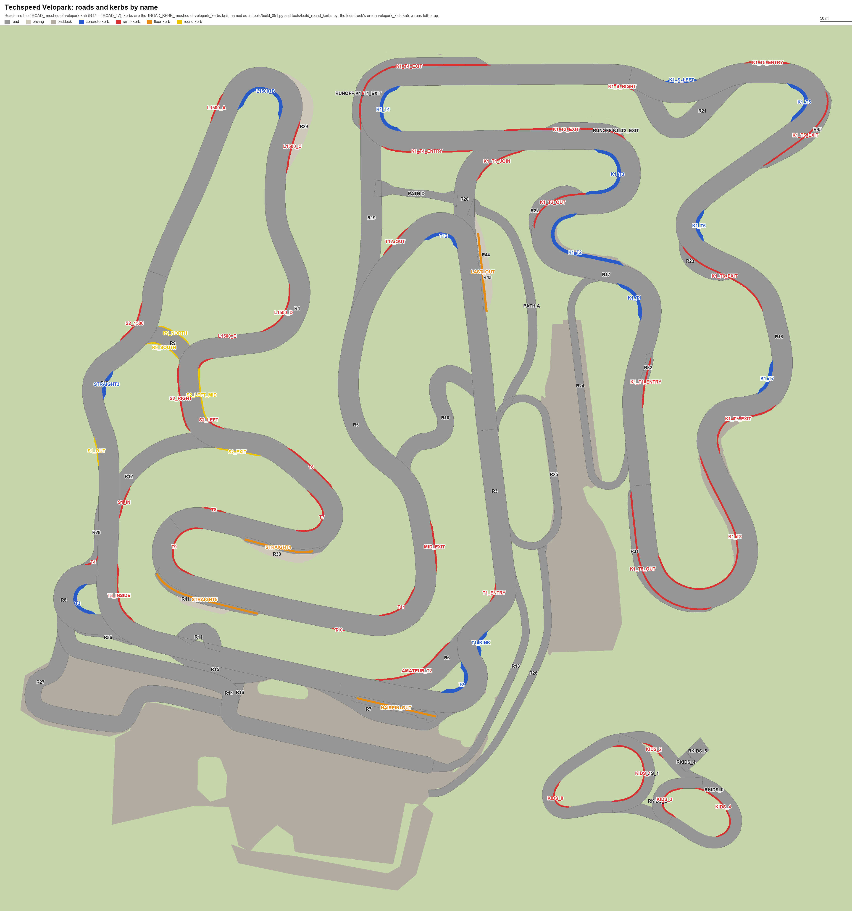
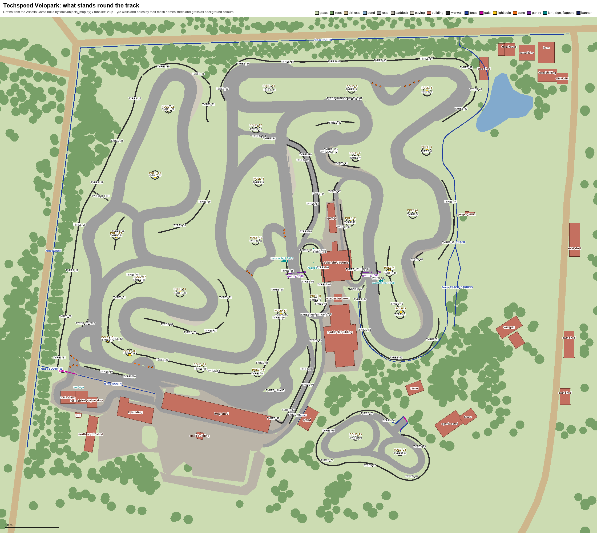

# Contributing to Techspeed FuelTech Velopark

How the track is made, for anyone changing it. Playing it? See the [README](README.md).

The track is made from its sources in [source/](source), its layouts and changelog in [source/track](source/track); its [README](source/track/README.md) is the one that ships with it. `tools/build_tracks.py` builds both games from the sources (see [Sources](#sources)), and `release.ps1` packs the release (see [Making a release](#making-a-release)).

## Folders

| Folder | What is in it |
|---|---|
| `source/` | The track's sources from 0.6.0: models, textures and track files, that `tools/build_tracks.py` builds each game from. See [Sources](#sources). |
| `tools/` | The build, the scripts that change the sources, and the scripts that made the 0.5.1 kerbs, light poles, start panel and road marks and render previews of them. |
| `tools/reference/` | Photos of the real track and textures taken from the old one, that the tools work from. |
| `tools/reference/elevation/` | Google's heights of the real ground, where the track lies on the Earth, and how its ground compares, from `tools/elevation.py`. See its [README](tools/reference/elevation/README.md). |
| `docs/` | The README's screenshots, of each game in `screens/ac` and `screens/beamng` (the overtake.gg page uses the Assetto Corsa ones too), and the track and objects maps below. |
| `overtake/` | The overtake.gg description. |
| `.github/workflows/` | The release action. |

The source models (`.glb`) and textures are stored with Git LFS, as some are over GitHub's 100 MB file limit. Install [Git LFS](https://git-lfs.com) before cloning.

## Track map

Every road and kerb of the track by name, to point at one when talking about a change. Roads are the `1ROAD_` meshes of `velopark.kn5` (`R17` is `1ROAD_17`). Kerbs are the `1ROAD_KERB_` meshes of `velopark_kerbs.kn5`, named as in `tools/build_051.py`, the round ones as in `tools/build_round_kerbs.py`; the vp_1000's start with `K1_`. The kids track's roads and kerbs are the `1ROAD_KIDS_` and `1ROAD_KERB_KIDS_` meshes of `velopark_kids.kn5`. Blue kerbs are concrete, red ones painted ramps, yellow ones round kerbs, and orange ones floor kerbs. The map shows the track as it lies on the ground: x runs to the left and z up.

[](docs/track_map.png)

After changing the track, `python tools/track_map.py` draws it again from the Assetto Corsa build in `build/ac`.

## Objects map

What stands round the track, by name, to point at one when talking about a change: the buildings by what they are, the tyre walls (`TYRES_` meshes of `velopark_tyres.kn5`, or of `velopark_kerbs.kn5`) and light poles (`POLE_`, of `velopark_poles.kn5`) by their mesh names, the fences (`velopark_outside.kn5`'s `FENCE_` meshes) by theirs. Grass, trees, the dirt roads and the pond are only background colours, the trees too many to draw each.

[](docs/objects_map.png)

After changing what stands round the track, `python tools/objects_map.py` draws it again from the Assetto Corsa build in `build/ac`.

## The ground and the surroundings

The track's heights and what stands round it are made from the real ground's heights, the ground photo, OpenStreetMap and screenshots of the real track, by tools run in turn (each finds its work done when run again):

1. `python tools/level_ground.py`: everything at the heights of the real ground, from Google's in `tools/reference/elevation/` (see its [README](tools/reference/elevation/README.md)).
2. `python tools/flatten_roads.py`: that levelling made the same across every road, so it twists none.
3. `python tools/fill_hollows.py`: the near ground's sunk points lifted to the ground round them.
4. `python tools/level_pavers.py`: R29's pavers laid on their plane, the grass brought up to them.
5. `python tools/restyle_paddock.py`: the paddock's buildings in grey block with salmon red pillars, without the race control tower and the fuel station, which `build_outside.py` makes again.
6. `python tools/build_outside.py`: `source/models/velopark_outside.glb`, with the dirt roads, the fences, the buildings outside the track, the race control tower, the fuel station, the marshals' tents, the flagpoles and the banners. It makes the model again each run.
7. `python tools/plant_outside.py`: the trees round the track in `velopark_extra.glb` and BeamNG's forest, clear of what `build_outside.py` made and of the track's infields; `--prune` takes out any new one standing in them. `--strip` plants the strip between the vp_1000's north tyre wall and the north fence thick with eucalyptus.
8. `python tools/settle_objects.py`: everything that stands on the ground (tyre walls, poles, buildings, trees) set back on it where the ground's large triangles did not follow the levelling; then `build_outside.py` again, which builds on the ground as it is.
9. `python tools/split_tyres.py`: gaps in the tyre walls where something stands in them, as the vp_1000's flag marshal's tent and cones.
10. `python tools/settle_kids.py`: the kids track's roads and kerbs, and its AI lines, set back 1 cm over the ground's large triangles round it, which had come to lie over them; then `python tools/lift_paint.py`, to bring its paint back over them.

## Making a release

1. Make the changes in `source/` and add a `## <version>` section at the top of `source/track/CHANGELOG.md`.
2. Run `.\release.ps1 -Version <version>`. It sets the version in the track's README, layout files and Custom Shaders Patch config in `source/track`, builds both games from the sources with `tools/build_tracks.py`, and packs `build\dist\techspeed-fueltech-velopark-<version>-ac.7z` for Assetto Corsa and `build\dist\techspeed-fueltech-velopark-<version>-beamng.zip` for BeamNG.drive. The build runs the Python in `.venv`, or the one on the path; pass `-Python <path>` to use another. Add `-Install` to copy the track into the game, or `-DryRun` to see what it would change.
3. Commit, then tag and push the tag:

   ```
   git tag v<version>
   git push origin main v<version>
   ```

The Release action builds `techspeed-fueltech-velopark-<version>-ac.7z` and `techspeed-fueltech-velopark-<version>-beamng.zip` from `source/`, as `release.ps1` does, and attaches both to a GitHub release, with the version's changelog section as its notes. Download the 7z from there and upload it to overtake.gg; the zip is the BeamNG.drive download.

## Tools

The tools need Python 3.13 and the packages in `tools/requirements.txt` (`bpy` is Blender as a Python module, used only for the preview renders):

```
pip install -r tools/requirements.txt
```

They also read files that are kept out of the repository:

| Path | What it is | How to get it back |
|---|---|---|
| `base/velopark-0.5.0/` | The 0.5.0 track, which `tools/build_051.py` builds 0.5.1 from. | Unpack the 0.5.0 release there. |
| `tools/textures/` | Kerb, floor kerb, pole and context textures. | `python tools/build_preview.py tex`, then `python tools/build_simple.py tex` |
| `tools/kn5/` | The lowered start panel models. | `python tools/build_simple.py gantry` |
| `build/` | Each game's build in `ac/` and `beamng/`, and the archives to release in `dist/`, as `techspeed-fueltech-velopark-<version>-ac.7z` and `techspeed-fueltech-velopark-<version>-beamng.zip`. | Made by the tools, `tools/build_tracks.py` and `release.ps1`. |

## Sources

From 0.6.0 the track is made from its sources in `source/`, for every game, instead of being processed again from the 0.5.0 track:

| Path | What it is |
|---|---|
| `source/models/<name>.glb` | Each model of the track as a glTF binary, which Blender opens. Everything Assetto Corsa needs that glTF has no place for (shaders, material values, mesh flags, LOD distances) is kept in the glTF custom properties under `kn5`. |
| `source/textures/` | The textures, each once, which the models point at. A texture two models hold different versions of goes in a folder named after the model, as `velopark_paddock/TarmacDark.dds`. |
| `source/track/` | The rest of the track as it ships: layouts, AI lines, ui, the Custom Shaders Patch config, README and changelog. |

`python tools/build_tracks.py` builds both games from them:

- `build/ac/content/tracks/techspeed_fueltech_velopark`, the Assetto Corsa track;
- `build/beamng/levels/techspeed_fueltech_velopark`, one layout for BeamNG.drive (`--layout`, `vp_1500` by default), unpacked: copy `build/beamng` into BeamNG's `mods/unpacked/techspeed-fueltech-velopark` to try it. `--pack` packs its zip in `build/dist` too.

Pass `ac` or `beamng` to build one game only. Only what changed since the last build is made again, so after editing a model a build takes a second or two; `--all` makes everything again. `--install` copies what changed into Assetto Corsa (the folder in `AC_TRACKS`, else the one `release.ps1` uses).

To edit a model in Blender: File > Import > glTF 2.0 the `.glb`, then File > Export > glTF 2.0 over it, as glTF Binary, with Include > Custom Properties on and Images set to None. The build then puts back what Blender changes: names it made unique with `.001`, moved objects, missing tangents, textures it leaves out. Faces with no area are dropped. A new material without `kn5` properties becomes a plain `ksPerPixel` one with its base colour texture; copy the properties from another material to choose its shader.

`tools/extract_sources.py` made `source/` once, from the 0.5.1 track as released, and checked that every model comes back the same, byte for byte. The kn5 reading and writing are in `tools/kn5tree.py`, the glTF ones in `tools/gltf_source.py`.

`tools/export_beamng.py [layout]` converts the Assetto Corsa build in `build/ac` into a BeamNG.drive level, `build/dist/techspeed-fueltech-velopark-<version>-beamng.zip`; `release.ps1` runs it every time. To try it: drop the zip in BeamNG's `mods` folder. It carries over the models, textures and surfaces of one layout (`vp_1500` by default), the lights, the tyre stacks' simpler copies for far away as their BeamNG detail levels, a start for every layout to pick from, with its picture, the layouts' racing lines as BeamNG's road network, which its map draws and its AI drives, with the paths across the infield and the pit lanes beside it, drawn as wide as the asphalt round them, and a timed race for each layout (`tools/beamng_races.py`), which BeamNG's Time Trials list too (the level's `quickrace` folder), and an AI race for each, against karts as the player's own (BeamNG's AI race, its racers driving the player's vehicle), from the layout's grid as AC has it, the player at its back, 9 racers at first and up to 35: a marker at its start that offers it, with a countdown, checkpoints and lap times. The start gantry's board shows the best ten laps of the layout raced under it and the race clock, and its start lamps follow the countdown, as `tools/beamng_board.py` lays them out and the level's Lua (`tools/beamng/`) runs them. Road traffic is off. The grass has a ground model of the level's own, BeamNG's grass with a soft layer 1 cm deep instead of 5, so a kart's tyres do not sink out of sight. The cones are loose cones of BeamNG's cones prop, which a level cannot hold as shapes: BeamNG's cone made the Assetto Corsa cone's size, 0.4 m wide and 0.7 m high, and 1.2 kg, as BeamNG's large cone, 4.2 kg, all but flips a kart that hits it. All the cones of a layout are one vehicle, a part of the cones prop of the level's own that `tools/beamng_races.py` writes (each cone still knocked about on its own), as 75 vehicles, one a cone, took a minute to spawn as a race started and stalled the frames as they woke; the level's Lua (`tools/beamng/lua/ge/extensions/techspeedFueltechVelopark/cones.lua`) spawns every layout's in free roam, with their distance boards, from the level's `cones.prefab.json` (each once where layouts share it), and each race spawns its own layout's from its mission's `mainPrefab.prefab.json`, as BeamNG's own time trials do. Each tree has a trunk to hit, unseen inside its boards. The eucalyptus plantation of `tools/build_trees.py` is BeamNG's forest: each tree as made is a forest item, with its trunk to hit, placed where Assetto Corsa's copies of it stand, turned and sized as they are (`source/models/velopark_extra_trees.json`), swaying a little in the wind; its understory stays shapes. The lights are BeamNG's night lights, as its own floodlit tracks' are, which the time of day switches on at night, with their intensity set as those tracks set theirs, as BeamNG's lights fall off far faster than Custom Shaders Patch's. As BeamNG grows no grass on meshes, `tools/beamng_grass.py` stands clumps of it where Assetto Corsa grows its own, near the racing line.

`tools/build_parking.py` takes the dirt the 0.5.0 track laid over the pits and the car park south of the pit building out of `source/models/velopark_paddock.glb`, so the paddock's asphalt shows there, and paints the car park's bays in `source/models/velopark_paint.glb`.

`tools/clear_walls.py` takes the 0.5.0 track's invisible walls out of `source/models/velopark.glb` where they stand across its asphalt: between the pit building and the car park, round the road by the buildings to the west and along the strip north of them, where the paddock's asphalt was laid past them.

`tools/build_paths.py` lays the two tyre-lined paths across the infield (A, from R20 down into the vp_1500 pit exit at R25, and D, from R19 to R20) as asphalt of their own in `source/models/velopark_paddock.glb`: between their tyre walls, eased along and across, widened into the roads at their ends, but for A's south end, which runs on straight into the pit exit as a road merging with it. Their asphalt is mapped as most of the paddock's is. The paddock's old strips there become ground in `source/models/velopark.glb`, which is lowered under the paths where they ease below it, with the tyre stacks standing there (`source/models/velopark_tyres.glb`). Run once; run again, it finds the paths laid.

`tools/join_paddock.py` then eases the paddock's asphalt into the track's roads where they meet, as at the car park and the pit lane: within 5 m of a road it bends from the road's height and slope at the seam to its own, so a kart crosses without a lip or a change of angle. Its big faces there are cut into a 1 m grid for it, and the paint on it moves with it. Run again, it finds the seams met.

`tools/grade_paths.py` then grades the ground beside the paths into them, as a bank beside a road would be: within 4 m of each side the grass of `source/models/velopark.glb` bends from just under the path's side to the ground as it is past that, meeting each in height and slope, so a path no longer runs through a bank cut beside it or stands on a wall of its skirts. It fills the dents laying the paths left near them too, and the tyre stacks there go up or down with the ground (`source/models/velopark_tyres.glb`). Where a road or anything else lies on the ground, the ground under it stays. Run again, it finds the ground graded.

`tools/plant_trees.py` then lowers the trees whose trunks end in the air: a tree's texture leaves a gap under its trunk, about 0.75 m on the broad leaf trees, so it lowers each tree until the lowest of its trunk that shows is 10 cm into the ground round it. Run again, it finds the trees planted.

`tools/build_trees.py` plants the eucalyptus plantation along the north and the west of the track, in `source/models/velopark_extra.glb`, in place of the 0.5.0 track's broad leaf and ash trees there. The trees are three dimensional, 27 to 37 m high: a trunk and branches of pale bark, bare up to the small clumps of leaves of the crown, on crossed cards. They stand in rows about 3 m apart in the 14 m of the band nearest the track, 6 m apart behind, where the old trees stood and nowhere within 3 m of a road, building, kerb or tyre wall. At their feet, from 4 m before the band to 9 m into it, a ragged mass of shrubs 3.5 to 8 m high, many small clumps of leaves, and young eucalyptus among it. Each trunk has an unseen wall round it up to 3.5 m, which cars hit in both games. The north west, round the L1500's top hairpin, is no plantation: broad leaf trees there, 9 to 16 m high with round crowns down low, wherever the ground's photo shows the crowns of trees, with the meadow round them as the photo has it. Their textures are made there too (`source/textures/euca_*.dds`). Run again, it finds the plantation planted.

`tools/lift_paint.py` then lifts the paint back over the asphalt wherever the asphalt came up over it: the edge line of the straight out of T2 went under the paddock's asphalt that `tools/join_paddock.py` eased into the road beside it. Every point of paint less than 2 mm over the asphalt under it, or whose face dips under it between its points, goes to 2.5 mm over it, as the rest of the paint lies. Run again, it finds the paint over the asphalt.

`tools/build_pavers.py` paves with concrete blocks, as the real track's are, R29, the light concrete beside the L1500's top hairpin, and the run-offs beyond the floor kerbs STRAIGHT4 (R30) and LAST_OUT (R43, R44), with the pieces of the roads beside them 0.5.1 patched them with, which no layout drives on: so each run-off is one paving. Beyond STRAIGHT4 the run-off is first a strip of asphalt along the track, as wide all along, reaching 0.8 m past the kerb, the paving outside it; the faces are cut along its edge. R41's run-off, beyond STRAIGHT5, stays asphalt, and a strip of paving 2.5 m wide is laid outside it, along the straight of its kerb (`1ROAD_PAVERS_STRAIGHT5`), growing out of the asphalt's edge over 5 m at each end. A material of its own, Pavers, and its texture made there (`source/textures/pavers.dds`): blocks 20 by 10 cm in rows a half block apart, mapped flat from above, the texture 6.4 m across so its shades make no pattern seen from far. The paving is driven as kerb: its meshes are named `1KERB_` (as `1KERB_29`), AC's kerb surface, with its rumble, sound and force feedback, which the BeamNG.drive export makes BeamNG's rumble strip. Run again, it finds them paved.

`tools/clear_runoffs.py` makes ground of the pieces of the paddock's asphalt 0.5.1 left round the vp_1000's K1_T3 and K1_T4, some past the tyre walls, which on the real track are ground; the asphalt run-offs it laid there stay. As the ground has holes under them, each becomes ground in its place: the ground's photo mapped as the ground's is, named `1GRASS_` so both games drive it as grass, and grass grown on it. What is left of the paddock's own asphalt there, out of sight under the ground and the run-offs but for its edges, goes. Run again, it finds them cleared.

`tools/build_mouth_lines.py` paints a line across the whole road before T12, where the road the vp_1500 turns off begins to part from it, a few metres before the southernmost of the cones between them: square to the road as it runs before the junction, from edge line to edge line, as the real track has it. Run again, it finds it painted; `tools/lift_paint.py` after it.

`tools/fix_seams.py` takes out the steps where two roads meet a few centimetres apart in height, a seam at a time, as listed in it: the road named is eased into the other within 2 m of where they meet, the grass and anything else sharing its edge going exactly as far, the paint and kerbs on it with it, the road it meets left as it is. So far: R24 into R17, on the vp_1000, up to 4.9 cm; and the ground round the paddock's asphalt into it, which `tools/join_paddock.py` had moved up to 19 cm away from the grass, leaving holes at K1_T8 and K1_T2. Ground eased keeps its edges where it meets a road, kerb or tyre wall, and moves only other ground with it. Run again, it finds them level.

`tools/build_board_objects.py` makes the layouts' distance boards loose objects, as the cones are, that a kart knocks over. They were walls in models of their own (`vp_*_boards.glb`, and a 50 m board in `velopark_board50.glb`); each now goes in its layout's own model, `source/models/vp_<layout>.glb`, beside the cones, as AC takes loose objects as `AC_POBJECT_0`, `AC_POBJECT_1` and on: numbered on from the layout's last cone, each a dummy with the box AC moves it by and the board drawn, standing on the ground under it, none of it in the ground. The layouts load the boards' old models no more, and they are gone. BeamNG.drive knocks the boards about too: each is part of its layout's one vehicle of cones, a box of eight nodes with the board's mesh on them, 2.5 kg. Run again, it finds them loose.

`tools/build_gantry_legs.py` makes the two legs at each end of the start gantries' boards meet each other halfway up the board's end and hold it there, as the real gantry's do, in `source/models/velopark_gantry_*.glb`. Run again, it finds the legs met.

`tools/map_roads.py` maps the asphalt of the roads the 0.5.0 track stretched as the paddock's is. That track maps each road's asphalt along it, the texture's width across it, so on the pit lanes and the other narrow roads it is squeezed across them and stretched along them, about six times as much as on the track. Every road whose asphalt is more than 30% off the paddock's scale, in every model, is mapped flat from above at that scale, 10 by 35 m per texture; the asphalt being the same all over, the seams do not show. Run again, it finds the roads mapped.

`tools/build_round_kerbs.py` lays the round kerbs of the middle of the track in `source/models/velopark_kerbs.glb`: a little higher than the ramp kerbs, 9 cm against their 6, rounded across its 0.6 m, as wide as a ramp kerb, one long hump painted yellow all over, its paint the ramp kerb's made yellow, as round the S2 chicane of the real track. It takes the place of the ramp kerbs `S1_OUT` and `S2_EXIT` and of the middle of `S2_LEFT`, and runs along both sides of `R9` (`R9_NORTH`, `R9_SOUTH`). Its free ends grow out of the road's edge over two blocks, as the ramp kerbs' do; where it meets a ramp kerb, it takes the ramp kerb's shape over its last 1.5 m, so the one carries on into the other. Its texture, `source/textures/kerb_round.dds`, is made there too, from the ramp kerb's. Run again, it finds the kerbs laid.

`tools/build_051.py` copies `base/velopark-0.5.0` to `build/ac/velopark-0.5.1` and rebuilds 0.5.1 there. 0.5.1 was released from it; the track has been made from `source/` since. `tools/check_051.py` renders the corners of that 0.5.1 build.
