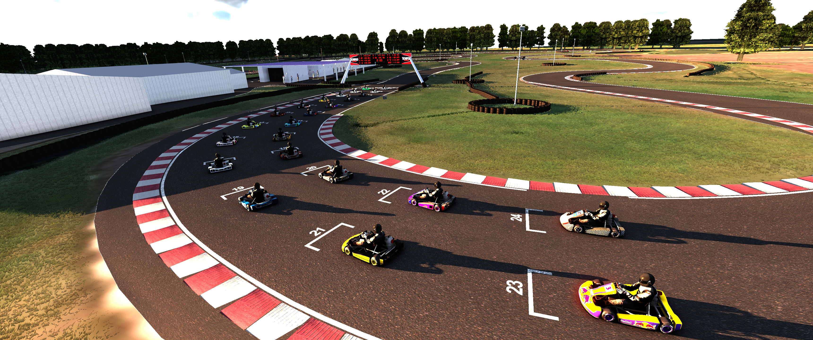
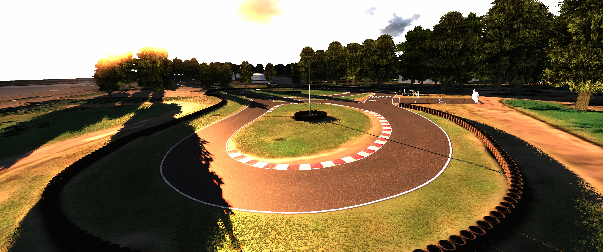
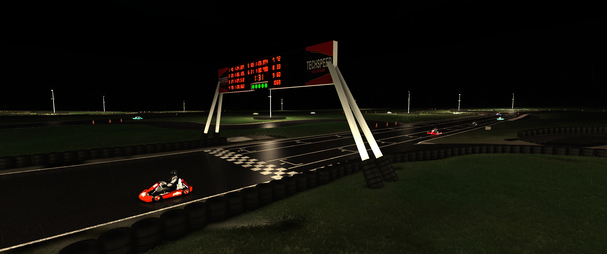
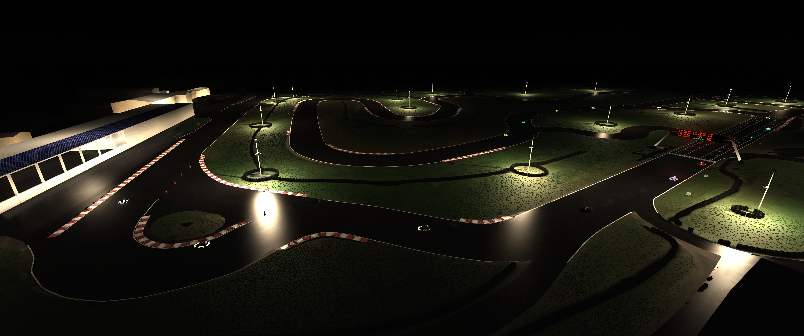
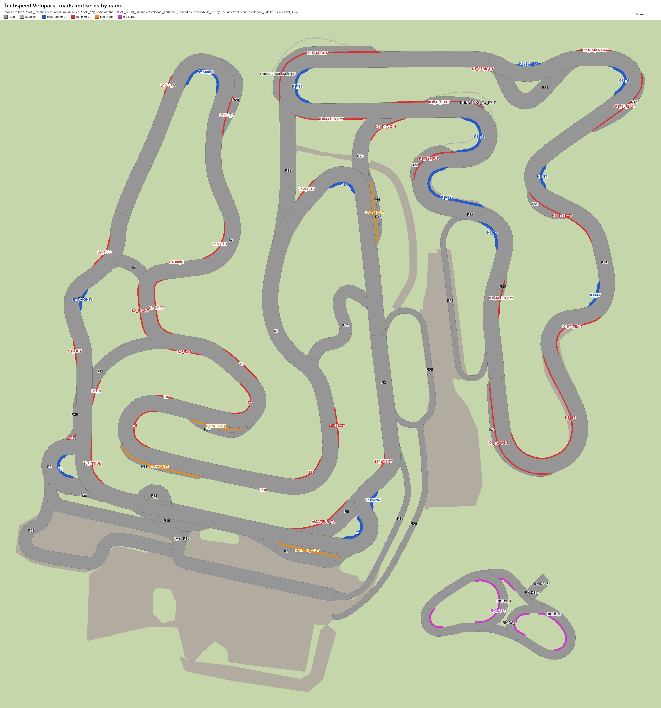

# Techspeed Velopark for Assetto Corsa

The Techspeed Velopark karting circuit in Nova Santa Rita, Brazil, for Assetto Corsa: eight layouts, from the 227 m kids track to the 2.5 km endurance layout. Released on overtake.gg.

The track itself, with its layouts and changelog, is in [content/tracks/techspeed_velopark](content/tracks/techspeed_velopark); its [README](content/tracks/techspeed_velopark/README.md) is the one that ships with it.

| | |
|---|---|
|  |  |
|  |  |

## Folders

| Folder | What is in it |
|---|---|
| `content/` | The track as it is released. Copy `content/tracks/techspeed_velopark` into the game's `content/tracks` to drive it. |
| `tools/` | Python scripts that made the 0.5.1 kerbs, light poles, start panel and road marks, and render previews of them. |
| `tools/reference/` | Photos of the real track and textures taken from the old one, that the tools work from. |
| `docs/` | The screenshots above, which the overtake.gg page uses too, and the track map below. |
| `overtake/` | The overtake.gg description. |
| `.github/workflows/` | The release action. |

The `.kn5` models and `.dds` textures are stored with Git LFS, as some are over GitHub's 100 MB file limit. Install [Git LFS](https://git-lfs.com) before cloning.

## Track map

Every road and kerb of the track by name, to point at one when talking about a change. Roads are the `1ROAD_` meshes of `velopark.kn5` (`R17` is `1ROAD_17`). Kerbs are the `1ROAD_KERB_` meshes of `velopark_kerbs.kn5`, named as in `tools/build_051.py`; the vp_1000's start with `K1_`. The kids track's roads are the `1ROAD_KIDS_` meshes of `velopark_kids.kn5`. Blue kerbs are concrete, red ones painted ramps, orange ones floor kerbs, and purple ones the old kerbs still there. The map shows the track as it lies on the ground: x runs to the left and z up.

[](docs/track_map.png)

After changing the track, `python tools/track_map.py` draws it again from `content/`.

## Making a release

1. Make the changes in `content/` and add a `## <version>` section at the top of `content/tracks/techspeed_velopark/CHANGELOG.md`.
2. Run `.\release.ps1 -Version <version>`. It sets the version in the track's README, layout files and Custom Shaders Patch config, and builds `build\velopark-<version>.7z` for Assetto Corsa and `build\velopark-beamng-<version>.zip` for BeamNG.drive to try out. The BeamNG step runs the Python in `.venv`, or the one on the path; pass `-Python <path>` to use another. Add `-Install` to copy the track into the game, or `-DryRun` to see what it would change.
3. Commit, then tag and push the tag:

   ```
   git tag v<version>
   git push origin main v<version>
   ```

The Release action builds `velopark-<version>.7z` and `velopark-beamng-<version>.zip` from `content/` and attaches both to a GitHub release, with the version's changelog section as its notes. Download the 7z from there and upload it to overtake.gg.

## Tools

The tools need Python 3.13 and the packages in `tools/requirements.txt` (`bpy` is Blender as a Python module, used only for the preview renders):

```
pip install -r tools/requirements.txt
```

They also read files that are kept out of the repository:

| Path | What it is | How to get it back |
|---|---|---|
| `base/velopark-0.5.0/` | The 0.5.0 track, which `tools/build_051.py` builds 0.5.1 from. | Unpack the 0.5.0 release there. |
| `tools/textures/` | Kerb, floor kerb, pole and context textures. | `python tools/build_preview.py tex`, then `python tools/build_simple.py tex` |
| `tools/kn5/` | The lowered start panel models. | `python tools/build_simple.py gantry` |
| `build/` | Rebuilt tracks, logs and archives. | Made by the tools and `release.ps1`. |

`tools/export_beamng.py [layout]` converts the track in `content/` into a BeamNG.drive level, `build/velopark-beamng-<version>.zip`; `release.ps1` runs it every time. To try it: drop the zip in BeamNG's `mods` folder. It carries over the models, textures and surfaces of one layout (`vp_1500` by default) and a start on its grid, but not the lights, the other layouts or timing.

`tools/build_051.py` copies `base/velopark-0.5.0` to `build/velopark-0.5.1` and rebuilds 0.5.1 there. Do not copy that over `content/` once `content/` has moved past 0.5.1, as it would undo the later changes. `tools/check_051.py` renders the corners of the track in `content/`.
