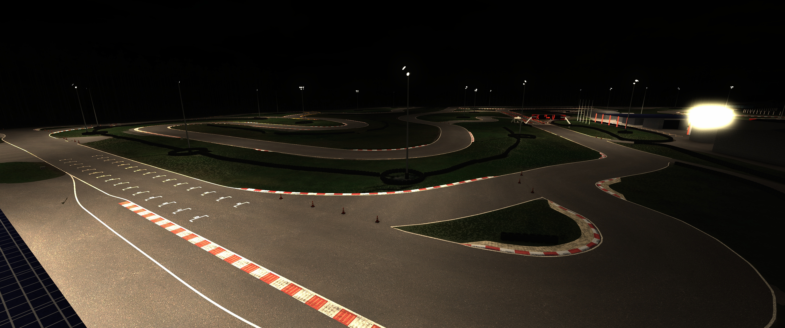
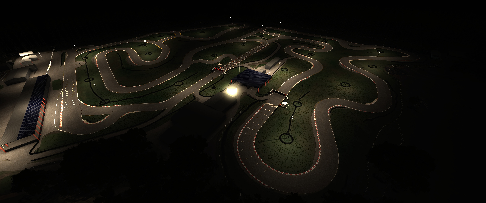
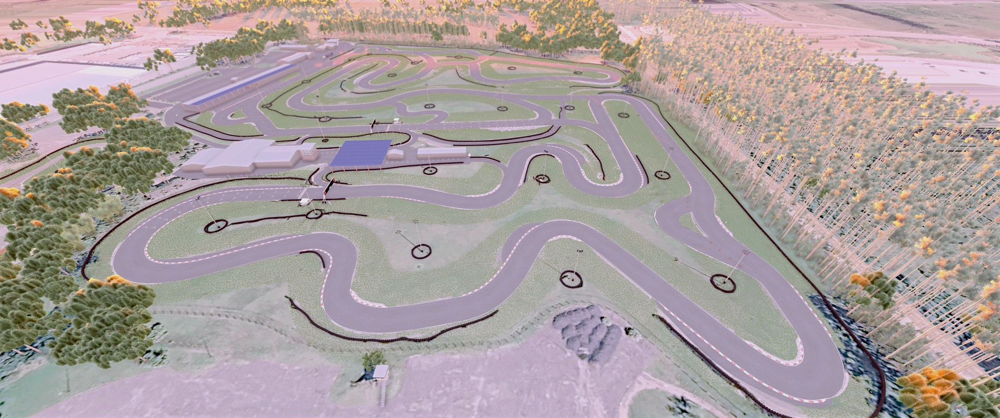
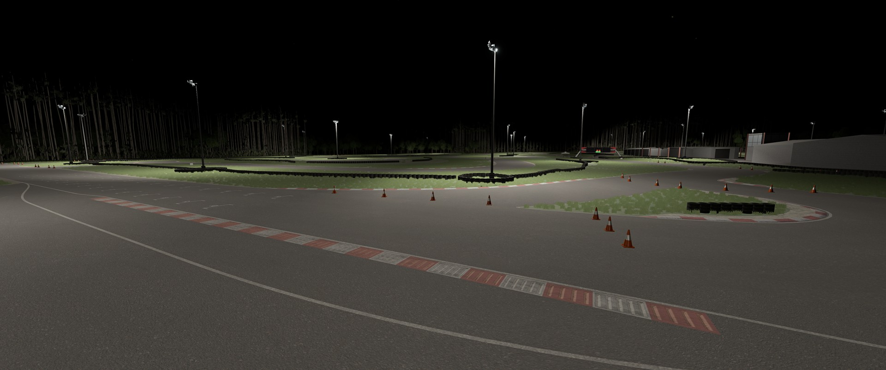
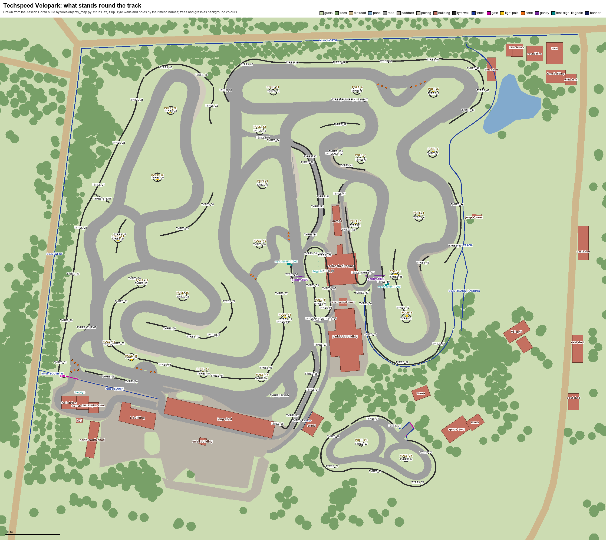

# Techspeed FuelTech Velopark

The Techspeed FuelTech Velopark karting circuit in Nova Santa Rita, Brazil, for Assetto Corsa and BeamNG.drive: eight layouts, from the 227 m kids track to the 2.5 km endurance layout, on the real ground's heights, with the paddock, the race control tower and the trees round it as they are. Download it from [overtake.gg](https://www.overtake.gg/downloads/techspeed-velopark.31817/) or [GitHub's releases](https://github.com/albertowd/techspeed-fueltech-velopark/releases).

## Screenshots

### Assetto Corsa

| | |
|---|---|
|  |  |

### BeamNG.drive

| | |
|---|---|
|  |  |

## Layouts

| Layout | Length | Direction | Max karts |
|---|---|---|---|
| Techspeed FuelTech Velopark 1000 | 1004 m | Clockwise | 24 |
| Techspeed FuelTech Velopark 1500 | 1517 m | Clockwise | 16 |
| Techspeed FuelTech Velopark 1500 Amateur | 1477 m | Clockwise | 16 |
| Techspeed FuelTech Velopark 1500 Short | 1217 m | Clockwise | 16 |
| Techspeed FuelTech Velopark 1500 Short Amateur | 1180 m | Clockwise | 16 |
| Techspeed FuelTech Velopark 1500 Hotlap | 1517 m | Clockwise | 36 |
| Techspeed FuelTech Velopark 2500 | 2541 m | Clockwise | 32 |
| Techspeed FuelTech Velopark Kids | 227 m | Anticlockwise | 3 |

The 1500 is the championship layout, with its pits at the centre building. The 1500 Amateur is the rental layout, with the easier inner corners; the 1500 Short turns in on the S and skips the northern loop, and the 1500 Short Amateur is the same with the inner corners. The 1500 Hotlap is the 1500 with its pits at the long pit building, starting just before the line so the first full lap is timed. The 2500 joins the 1500 and the 1000, as raced in the 2 to 12 hour races overnight.

## Download

Download the latest version from [GitHub's releases](https://github.com/albertowd/techspeed-fueltech-velopark/releases) or from its [overtake.gg page](https://www.overtake.gg/downloads/techspeed-velopark.31817/):

- `techspeed-fueltech-velopark-<version>-ac.7z` for Assetto Corsa;
- `techspeed-fueltech-velopark-<version>-beamng.zip` for BeamNG.drive.

See the [changelog](source/track/CHANGELOG.md) for what is new in each version.

## Installing

### Assetto Corsa

Unpack the 7z and copy its `techspeed_fueltech_velopark` folder into `assettocorsa/content/tracks`. If you have an older version in a `techspeed_velopark`, `velopark` or `kart_velopark` folder, delete that folder. When updating, delete the old `techspeed_fueltech_velopark` folder first rather than unpacking over it, as some tools skip files of the same size.

Custom Shaders Patch is recommended. It adds the grass, rain effects, the night lights and the live leaderboard on the start gantry. The track still loads without it, and the start lights still work, but those features are missing.

Servers need this same version of the track. The Kids layout must be added to the server as its own layout.

### BeamNG.drive

Drop the zip in BeamNG's `mods` folder as it is, without unzipping it, and pick Techspeed FuelTech Velopark in the level menu. The level is the 1500's track, with every layout's start to choose from, and for each layout a time trial (also in BeamNG's Time Trials) and an AI race against up to 35 karts, from a marker at its start. The start gantry's board shows the layout's best ten laps and the race clock, and its lamps follow the countdown. The floodlights come on at night.

## Known limits

- The AI lines are generated from the track geometry, not recorded from a driven lap, so AI pace may need tuning.

## Track map

Every road and kerb of the track by name (`R17` is road 17, the vp_1000's start kerbs begin with `K1_`), to point at one when reporting a problem. Blue kerbs are concrete, red ones painted ramps, yellow ones round kerbs, and orange ones floor kerbs. North is up.

## Objects map

What stands round the track, by name: the buildings, the tyre walls (`TYRES_`), the light poles (`POLE_`) and the fences (`FENCE_`). Grass, trees, the dirt roads and the pond are background colours.

## Credits

Barrier tyre: ["Tire"](https://sketchfab.com/3d-models/tire-44168cfdb8044ea8b242c1734d9cb3f9) by [TahirNilin](https://sketchfab.com/TahirNilin), licensed under [CC Attribution 4.0](http://creativecommons.org/licenses/by/4.0/). Changes made to the model: reduced to fewer sides with hidden faces removed, rescaled, textures reduced in size, and the colour texture cleaned of dirt and stains.

Ground texture: satellite imagery from Google Maps, imagery (c) Google and its providers. Ground heights: Google's Elevation API and OpenStreetMap.

## Contributing

How the track is made from its sources, the tools that change them and how a release is made: see [CONTRIBUTING.md](CONTRIBUTING.md).
